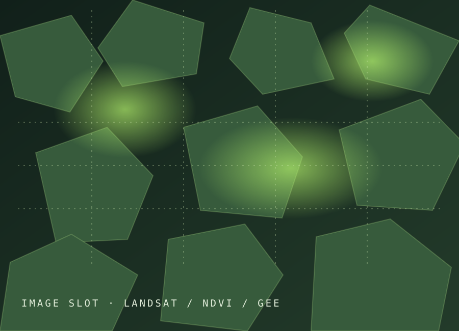

# Your Geospatial Portfolio — edit and update guide

This folder is a ready-to-edit static website made with HTML, CSS, JavaScript, and local image files. It starts in dark mode, has a light-mode switch, works on phone screens, and includes places for project maps, photos, reports, GitHub repositories, code examples, and Google Earth Engine apps.

## 1. Open and preview the site

1. Open `index.html` in a web browser to view the homepage.
2. Open `projects.html` to see the project archive and its filters.
3. Open `about.html` to edit your profile and public contact links.
4. Keep all pages, `styles.css`, `app.js`, and the `assets` folder together. The pages refer to each other by their relative file names.

You can edit the files with VS Code, another text editor, or GitHub's web editor. The text between HTML tags is the content. The CSS file controls colors and layout. The JavaScript file controls the theme switch, mobile menu, project filters, and current year.

## 2. Know what each file is for

| File or folder | What you edit there |
| --- | --- |
| `index.html` | Homepage headline, short introduction, featured projects, and main GitHub profile link |
| `projects.html` | Project cards, summaries, categories, image paths, and links to code, papers, or live maps |
| `about.html` | Bio, portrait, skills, LinkedIn, email, and other public contact links |
| `project-template.html` | Copy this page when you want a detailed page for one project |
| `styles.css` | Site appearance, colors, type, spacing, dark/light themes, and phone layout |
| `app.js` | Theme switch, small-screen menu, project filters, and automatic copyright year |
| `assets/` | All photos, maps, diagrams, screenshots, and the current placeholder artwork |

## 3. Replace the photos and maps

1. Put image files inside `assets/`. Use short lowercase names without spaces, for example `palamau-ndvi-map.png`.
2. Use JPG for photographs and PNG or SVG for maps/diagrams. Keep images reasonably small so the site loads quickly.
3. Find the matching `` in the page you are editing and change the path. For example:

   ```html
   
   ```

   becomes:

   ```html
   
   ```

4. Write a useful `alt` description for each image. If the image is a map, describe the location and what it shows. Do not use an image without permission to publish it.

The homepage uses `assets/batha-placeholder.svg` and `assets/palamau-placeholder.svg`. The Projects page uses one image per card. The About page uses `assets/profile-placeholder.svg`. The case study template has a main image and a gallery image slot.

## 4. Add or edit a project card

On `projects.html`, find the comment `PROJECT CARD`. Each project card is one `<article class="project-card"> ... </article>` block.

To add another project:

1. Copy one whole `<article>` block and paste it before the closing `</div>` for `project-list`.
2. Give it a unique `id`, such as `gee-urban-growth`.
3. Change the image path, image description, number, title, location, summary, tool names, and tags.
4. Set `data-category` to one or more of these exact words: `gis`, `remote-sensing`, `gee`, `research`. Separate multiple categories with a space, for example `data-category="gee remote-sensing"`.
5. Change the links to your own case study, GitHub repository, Earth Engine app, paper, report, or poster.
6. If you add a new filter category, add a matching filter button near `FILTER BY APPROACH`. Its `data-filter` value must match the category word.

The project filters read these category words automatically. The displayed project count updates when a visitor clicks a filter.

## 5. Create a detailed project page

1. Make a copy of `project-template.html` in the same folder. Give the copy a short name such as `palamau-forest-health.html`.
2. Search for `[EDIT` and replace the title, study area, year, methods, tools, findings, limitations, and your contribution.
3. Replace the image paths with your files in `assets/`.
4. Update the matching project's `CASE STUDY` link in `projects.html` to the new file name. The three starter cards currently point to the shared template; change those links before publishing so each opens its own finished case study.
5. Delete sections you do not need. Keep results accurate and state limitations clearly.

The template includes sections for your research question, input data, workflow, findings, image gallery, lessons learned, code sample, and optional Google Earth Engine app.

## 6. Add GitHub links or code

- To link to code, replace `https://github.com/YOUR-USERNAME/YOUR-REPOSITORY` with the real repository URL.
- Use the GitHub link for a complete project repository, notebook, script, or data-processing workflow.
- For a short code excerpt, use the optional `Code sample` section in a detailed project page. Keep it short and readable.
- Never publish passwords, API keys, access tokens, private datasets, or code that exposes credentials. Remove them from code before putting it online.
- A repository link is optional. If you do not have a public repository for a project, delete that link from the card.

## 7. Add a Google Earth Engine project

For each Earth Engine project, you can include one or more of these:

- **Project card:** label it with `GEE` and add the live app link.
- **Detailed case study:** explain the question, satellite/data sources, dates, processing steps, map layers, results, and limitations.
- **Live interactive app:** replace `https://YOUR-GEE-APP-URL` with your shared Earth Engine App URL. Check the app's access settings from a signed-out/private browser before sharing; a link or embed will not work for visitors who lack access.
- **Embedded map:** in the case study template, replace `APP_URL` in the example `<iframe>` with the shareable app URL, then remove the surrounding HTML comment markers (`<!--` and `-->`). If embedding is blocked or awkward, keep a normal `LIVE GEE APP` link instead.
- **Source code:** add a GitHub repository link for the Earth Engine script or supporting code. Do not publish credentials or private data.

## 8. Add links, reports, and downloads

Use a full web address beginning with `https://` for external links. On the project card, replace the GitHub, live app, paper, or documentation URL. For a document you want visitors to download, add it to `assets/` and link to it, for example:

```html
<a href="assets/palamau-project-report.pdf" target="_blank" rel="noopener noreferrer">READ PROJECT REPORT ↗</a>
```

Only upload documents you are allowed to share publicly. Consider removing personal phone numbers, private addresses, signatures, student IDs, and non-public project data.

## 9. Personalize the profile and contact details

- In `index.html`, edit the main headline and introduction.
- In `about.html`, update your bio, skills, portrait image, and social/contact links.
- Replace `YOUR-LINKEDIN-PROFILE` and `YOUR-PUBLIC-EMAIL@example.com` with the details you choose to make public, or remove those buttons.
- The GitHub profile link is already set to the account listed on your CV. Change it if you prefer a different profile.
- Avoid publishing passport numbers, date of birth, home address, or other details you do not want indexed online.

## 10. Change the look

The site opens in dark mode. Visitors can switch to light mode; their choice is remembered in that browser.

- Edit the color variables at the top of `styles.css` to adjust the dark palette.
- Edit the matching `html[data-theme="light"]` variables to adjust light mode.
- Edit the page layout, typography, and responsive rules in `styles.css`.
- If you only want dark mode, remove the theme-toggle buttons from each page and its theme-switching code from `app.js`.
- The font links need an internet connection. If they are unavailable, the site falls back to familiar system fonts.

## 11. A simple daily or weekly update routine

1. Add a dated note about what you worked on in a private study log.
2. When a project milestone is ready to share, edit its project summary and case study.
3. Add new maps or photographs to `assets/`, update their file paths and descriptions, and keep originals backed up elsewhere.
4. Add a repository, report, publication, or Earth Engine app link when it is ready for public viewing.
5. Open Home, Projects, and About in a browser. Click every new link and check the pages at phone width.
6. Save and publish the change through GitHub. Keep private or unfinished work out of the public repository.

You do not need to publish every day. Small, accurate updates after meaningful milestones make a stronger portfolio than unfinished claims.

## 12. Publish with GitHub Pages

This is a static site, so it does not need a server or database. To publish it:

1. Create a GitHub repository for the portfolio. A personal site repository is normally named `YOUR-GITHUB-USERNAME.github.io`; a project repository can have another name.
2. Put the **contents of this folder** at the top level of that repository: `index.html`, the other HTML pages, `styles.css`, `app.js`, and `assets/`.
3. Push or upload those files to GitHub.
4. In the repository, open **Settings → Pages**. Select **Deploy from a branch**, choose the branch holding the files (usually `main`) and the root folder, then save.
5. Wait for the Pages deployment to finish and open the site address shown in Settings → Pages.
6. After future edits, save and push/upload the changes. The public site updates after the next deployment.

GitHub Pages requires the entry `index.html` at the top of the selected publishing folder. With GitHub Free, the repository must be public for Pages. The site and everything in it can be viewed publicly, so remove private information and check your repository visibility before publishing.

Official instructions: [Create a GitHub Pages site](https://docs.github.com/en/pages/getting-started-with-github-pages/creating-a-github-pages-site) · [Configure a publishing source](https://docs.github.com/en/pages/getting-started-with-github-pages/configuring-a-publishing-source-for-your-github-pages-site).

## Before publishing checklist

- [ ] Replace every placeholder link (`YOUR-...`) or remove the link.
- [ ] Replace any images you do not want to keep, and add meaningful alt text.
- [ ] Remove `[EDIT ...]` text and unused template content from pages you publish.
- [ ] Confirm all project descriptions, numbers, dates, and publications are accurate.
- [ ] Open and click through every page on desktop and phone width.
- [ ] Confirm Google Earth Engine apps, GitHub repositories, reports, and social profiles are viewable by your intended audience.
- [ ] Remove personal or confidential information from pages, images, reports, and code.

